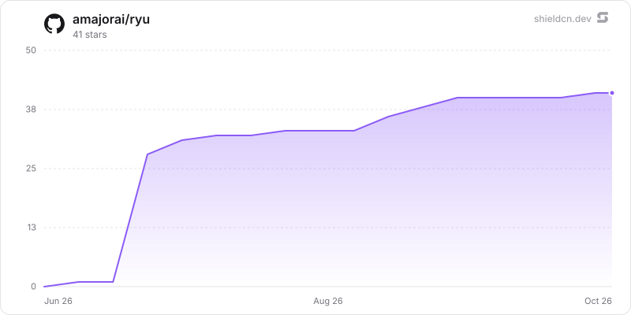

<p align="center">
  <a href="https://ryuhq.com">
    <picture>
      <source media="(prefers-color-scheme: dark)" srcset=".github/banner-dark.png" />
      
    </picture>
  </a>
</p>

<h1 align="center">Ryu</h1>

<p align="center">
  A managed AI deployment platform: we deploy and run your AI agents in the cloud, so you don't have to maintain anything.
</p>

<p align="center">
  <a href="https://github.com/amajorai/ryu/stargazers"></a>&nbsp;
  <a href="https://github.com/amajorai/ryu/releases"></a>&nbsp;
  <a href="https://github.com/amajorai/ryu/actions/workflows/ci.yml"></a>&nbsp;
  <a href="https://docs.ryuhq.com"></a>&nbsp;
  <a href="https://ryuhq.com/discord"></a>&nbsp;
  <a href="https://x.com/ryuhq"></a>&nbsp;
  <a href="./LICENSING.md"></a>
</p>

## Why Ryu

Building an AI agent is easy. Running it in production is the hard part: hosting, permissions,
secrets, integrations, monitoring, updates, and costs. Bring your agent, connect the tools and
models it needs, and Ryu keeps it running. An integration layer connects your apps, tools, models,
and workflows, and plugins and SDKs let you extend Ryu or build on it without rebuilding the
infrastructure.

- **Run it where you want**: on your machine, on your own server, or managed in Ryu Cloud.
- **Bring your own agent and models**: use an existing agent or harness with the providers you choose.
- **Stay in control**: routing, budgets, approvals, and audit through the Gateway.
- **Connect anything**: tools, MCP servers, skills, and plugins.
- **Reach it anywhere**: Desktop, Web, CLI, mobile, bots, and channels.

## Get started

Ryu Cloud runs your agents for you; [join the waitlist](https://ryuhq.com) or
[download the desktop app](https://ryuhq.com/download). To self-host instead, install Core and
Gateway from this repository. No Ryu account or control-plane service is required.

**macOS and Linux**:

```bash
curl -fsSL https://raw.githubusercontent.com/amajorai/ryu/main/install.sh | sh
ryu-cli
```

**Windows PowerShell**:

```powershell
irm https://raw.githubusercontent.com/amajorai/ryu/main/install.ps1 | iex
ryu-cli
```

The installer starts Core and Gateway with bundled local defaults. Next steps:
[self-hosting guide](https://docs.ryuhq.com/docs/start-here/getting-started/self-host) ·
[documentation](https://docs.ryuhq.com).

To try it without installing, open a Codespace. It starts Core and opens the Ryu web app on your
own Codespaces quota.

<a href="https://codespaces.new/amajorai/ryu?quickstart=1"></a>

## How Ryu compares

Ryu is not another framework for writing agents. It runs the agents and harnesses you already use,
with your own models, on your machine, your server, or in Ryu Cloud. Side-by-side comparisons with
agent frameworks, local runtimes, and managed agent platforms are at
[ryuhq.com/compare](https://ryuhq.com/compare).

## Repository map

- **This repository**: Core, Gateway, CLI, Desktop, Island, shared runtime packages, and self-hosting files.
- **SDKs and examples**: the [public SDK hub](https://github.com/amajorai/ryu-sdk).
- **Apps**: each app in its own `amajorai/ryu-<app>` satellite repository.
- **Plugins and catalog**: the [Marketplace repository](https://github.com/amajorai/ryu-marketplace).

## Licensing

Core and SDK are Apache-2.0. Gateway is AGPL-3.0. Desktop, Island, and shared UI packages are
source-available under [`LICENSE-COMMERCIAL.md`](./LICENSE-COMMERCIAL.md). See
[`LICENSING.md`](./LICENSING.md) and [`TRADEMARK.md`](./TRADEMARK.md) for the full boundary. Ryu
is pre-1.0, so interfaces, APIs, and on-disk formats may change between releases.

## Contributing

Open a pull request in this repository for code or docs; start with the
[contribution guide](./CONTRIBUTING.md). Report security issues through
[SECURITY.md](./.github/SECURITY.md).

## Star History

<a href="https://github.com/amajorai/ryu/stargazers">
  <picture>
    <source media="(prefers-color-scheme: dark)" srcset="./.github/shieldcn/star-chart-dark.svg" />
    
  </picture>
</a>
