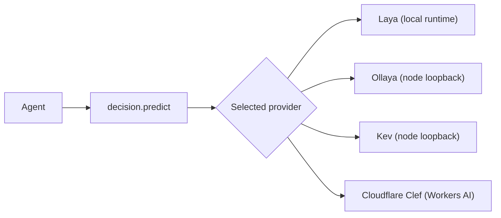

Decision models answer typed questions about text or JSON in one inference pass. They return
structured choices, scores, or yes/no answers; they do not generate a chat response.

Ryu exposes them in the node selector's **Decision Models** layer, on the **Engines & models** page
of its expanded view. Enable a provider and select it there. Agents call the same
`decision.predict` tool whichever provider is selected.



## Providers

| Provider | Where inference runs | Setup |
|---|---|---|
| [Laya](/docs/plugins/laya) | In a private local runtime managed by Ryu | Enable **Laya Local Decisions**. Ryu installs its pinned checkpoints. |
| [Ollaya](/docs/plugins/ollaya) | In the Ollaya service running on the selected Ryu node | Install Ollaya, run a decision model, then enable **Ollaya Decision Models** in Ryu. |
| [Kev](/docs/plugins/kev) | In the Kev server already running on the selected Ryu node | Start Kev on port `8009`, then enable **Kev Decision Models**. Ryu does not download its weights or start it. |
| [Cloudflare Clef](/docs/plugins/cloudflare-clef) | Cloudflare Workers AI | Enable **Cloudflare Clef Decisions** and configure the account ID and API token in that node's settings. |

### Ollaya

Ollaya's compatible API uses `POST /v1/systemone` for typed decisions and `GET /v1/models` to list
models already on that machine. Its default local service address is `http://127.0.0.1:11435`.

Follow [Ollaya's TypeSafe compatibility guide](https://ollaya.dev/docs/typesafe-compatibility) to
install the service and pull a model. The Ryu Ollaya provider only calls the node's loopback
service; it does not download or start Ollaya.

### Kev

Kev uses the same TypeSafe-compatible `POST /v1/systemone` shape. Start a local server from Kev's
official repository. For example, this command loads Kev-4B:

```sh
uv run --extra serve python -m kev.serve --run jaredpalmer/kev-4b --port 8009
```

Ryu sends requests to the loaded server at `http://127.0.0.1:8009` and defaults `model` to
`kev-latest`. The model server and weights remain separate from Ryu.

<Callout type="info">
The Kev and Ollaya connectors support a keyless local server only. Core does not send credentials
over plaintext HTTP, so they do not support a server configured with `KEV_API_KEY` or
`OLLAYA_API_KEY`.
</Callout>

## Call a typed decision

The canonical tool accepts a state and one or more questions:

```json
{
  "state": "Third time this year you've double-charged me. Refund it today or I'm cancelling.",
  "questions": {
    "intent": {
      "type": "choice",
      "instructions": "What does the customer want?",
      "criteria": {
        "refund": "Wants money back",
        "invoice": "Needs an invoice or receipt",
        "other": "Anything else"
      }
    },
    "urgent": {
      "type": "noul",
      "instructions": "Does this message need a response today?"
    }
  }
}
```

Question types are `choice`, `score`, and `noul` (a calibrated yes/no probability). The result
contains structured `answers` and model usage metadata; it is not prose.

`model` is optional. Each provider has its own default:

| Provider | Default `model` | Other accepted values |
|---|---|---|
| Laya | its router profile | |
| Ollaya | the `laya` model alias | |
| Kev | `kev-latest` | |
| Cloudflare Clef | `clef` | `clef-flash` |

### Images

`decision.predict` accepts text or JSON state. When Cloudflare Clef is selected, Ryu also advertises
`decision.predict_multimodal` for requests with embedded images. This separate verb appears only for
providers that declare image support.

Clef accepts up to four embedded PNG, JPEG, or WebP images, sent to Cloudflare with the state and
questions. The Cloudflare model page also lists video as an input. Ryu sends the Workers AI REST
schema's embedded `images` field and does not expose a video-file field.

### Errors

Provider errors remain visible. Ryu does not switch providers automatically, and does not silently
use a different model when the selected provider is offline or the requested checkpoint is missing.

## Gateway content screening

A local decision model can also be the Gateway's
[hazard screener](/docs/gateway/model-screening#hazard-screener), the primary screener kind. The
Gateway asks it a fixed, versioned set of closed-choice questions about each message:

- one yes or no question for each hard category (`S4` and `S9`), so a likelier soft category can
  never hide them;
- one question for the most likely other hazard category;
- one question for prompt attacks.

The screener reads the probability of each answer, not prose. It calls the model's
`POST /v1/systemone` endpoint directly. It is not a `decision.predict` call and does not use the
provider you select in the node selector.

### On a Ryu node

Screening is off by default. When you opt in, Core hands the Gateway the address of a Kev or Ollaya
server you run on that machine, and can also run a guard model beside it. See
[Screener endpoints from a Ryu node](/docs/gateway/model-screening#screener-endpoints-from-a-ryu-node).
The Laya provider is not reachable this way, because its runtime answers only through Ryu's
authenticated tool route.

### On Ryu's hosted Gateway

The hosted Gateway's primary screener is a local decision model that Ryu runs next to it on a
private network, on CPU. Guard models and the LLM-judge inspector are alternative backends behind
the same interface.

Until a backend has passed Ryu's offline qualification for the hard categories, the hosted Gateway
screens in reduced mode (the platform policy's patterns plus a per-organization rate) instead of
refusing every request. See [Content screening](/docs/gateway/organization-policy#content-screening).

### Remote decision APIs

A remote decision API with the same wire, such as TypeSafe's Jev, can screen for your own Gateway
only when you set `allow_remote_processor = true` for it, because your prompts are then sent to
TypeSafe. Ryu's hosted Gateway never uses one by default: it would first need recorded data
retention terms approved by a second Ryu administrator.

A self-hosted or bring-your-own-key Gateway is never bound by Ryu's platform policy, so its screener
choice is always its operator's.

## Separate model roles

Ryu runs several small models, and each has one job. This section is the canonical list.

| Role | Model | Job | Reference |
|---|---|---|---|
| Decision Models | The provider selected in the node selector | Answer caller-supplied typed questions through `decision.predict` | This page |
| Classifier tier | Gemma 3 270M, owned by the Gateway | Firewall LLM inspector, smart-routing classifier, and LLM-judge evaluators | [Local Classifier Tier](/docs/core/classifier-tier) |
| Hazard screener | A local decision model or a guard model | Gateway content screening, never registered as a routable provider | [Gateway content screening](#gateway-content-screening) |
| Needle 3 | Tool and skill selector | Rank the already-scoped tool and skill catalog | [Unified Tool Catalog](/docs/core/unified-tool-catalog#ranking) |

The classifier tier is not the hazard screener. A 270M judge cannot tell a hazardous request from
one that merely mentions a topic, so screening runs on its own backends. Needle 3 does not provide
`decision.predict`. FunctionGemma is not a live provider in the classifier path or the Decision
Models layer.
