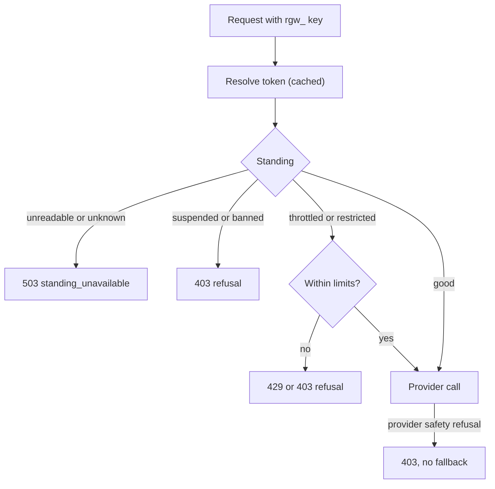
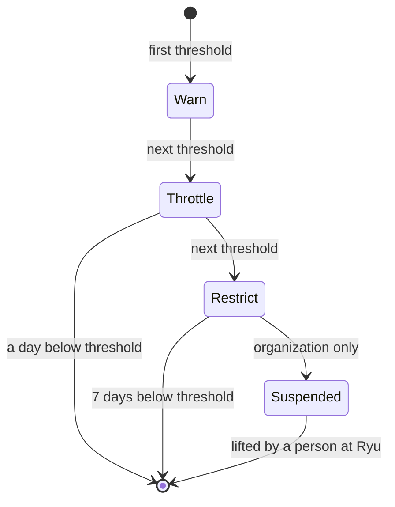
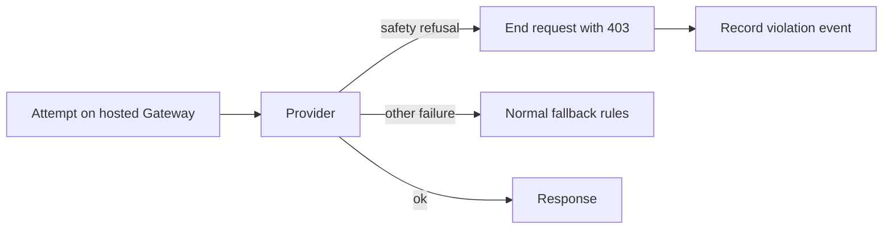

Every `rgw_` token resolution on the [managed data plane](/docs/gateway/managed-data-plane) also
carries the platform standing of the key and its owner. This page covers what the hosted Gateway
does with that standing.



## Account standing

When Ryu suspends an organization, suspends a key, or bans the account that owns a key, the token
still resolves. The Gateway refuses the request with a specific code instead of a generic `401`, as follows.

| Standing | Status | `error.code` | Refused on |
|---|---|---|---|
| Organization suspended for Ryu-managed traffic | `403` | `org_suspended` | the hosted Gateway (every request there spends Ryu credentials) |
| Organization fully suspended | `403` | `org_suspended` | every Gateway |
| Key owner banned | `403` | `user_banned` | every Gateway |
| Key suspended | `403` | `key_suspended_abuse` | every Gateway |
| Standing could not be read | `503` | `standing_unavailable` | every Gateway, with `Retry-After` |

### Refusal body

A refusal keeps `error.type: "policy_violation"` and adds these fields:

- `layer: "platform"`;
- `remedy: "appeal"`;
- the public `appeal_url`;
- `reason_class` and `until`, when they apply.

```json
{ "error": {
    "type": "policy_violation",
    "code": "org_suspended",
    "layer": "platform",
    "remedy": "appeal",
    "message": "This organization is suspended.",
    "appeal_url": "https://<your Ryu site>/appeal",
    "reason_class": "fraud",
    "until": "2026-11-01T00:00:00.000Z" } }
```

`appeal_url` is the public appeal page. It cannot file an appeal for a key or organization step on
its own. File that appeal from the **Appeal this decision** link in the notice email, or contact
Ryu support when the email carried no link. See
[Appeal an automatic step](/docs/security/authentication-account-restrictions#appeal-an-automatic-step).

### Scope and failing closed

- A suspension limited to Ryu-managed traffic does not affect a self-hosted Gateway or a managed
  node using your own provider keys.
- A restricted organization is still served, with the limits in
  [Throttled and restricted accounts](#throttled-and-restricted-accounts).
- The Gateway fails closed on standing. A missing, unreadable, or unrecognized standing is
  refused with `503 standing_unavailable` rather than served.
- On the hosted Gateway, a resolution whose credit balance could not be read is refused with
  `503 credit_accounting_unavailable` before any provider is called.

### How a change takes effect

A standing change reaches the Gateway through the resolve cache. When the Gateway is notified of
a change, it drops the affected cached resolutions at once. Work already running checks again:

- a tool loop (including the hosted `web_search` loop of the Responses API), before each round
  and before each follow-up completion;
- a request, before each fallback attempt;
- a stream, before each chunk it forwards.

A request refused before a fallback attempt or a later round gets the same `403` envelope, and the
next provider is not called.

Without a notification, a change applies when the cached resolution expires: within 60 seconds
for a key in good standing, or 10 seconds once its standing already refuses.

A stream refused mid-way ends after the text already delivered, with the same error fields in its
own dialect, and never with a normal finish:

| Endpoint | Last event |
|---|---|
| `/v1/chat/completions` | one `data:` frame carrying the error envelope |
| `/v1/messages` | an `error` event, `{ "type": "error", "error": { ... } }`, with no `message_delta` or `message_stop` after it |
| `:streamGenerateContent` | one `data:` frame carrying the error envelope, with no `finishReason` after it |
| `/v1/responses` | `response.failed`, whose `response.error` keeps the `code`, `message`, `appeal_url` and the other fields above |

## Throttled and restricted accounts

Short of a suspension, Ryu can narrow what a key, the account that owns it, or an organization may
do. These steps apply only on the hosted Gateway, where requests spend Ryu's provider credentials.
A self-hosted Gateway and a managed node using your own provider keys are never throttled or
restricted by them.

**Throttled.** The throttled key, account, or organization gets a lower request rate and a cap on
requests in flight. A stream counts as in flight until it ends or the client disconnects.

**Restricted.** Everything a throttle does, plus:

- content that Ryu's platform policy would only flag is blocked;
- image, speech, transcription, and video generation are refused (polling a video job submitted
  earlier still works);
- requests are not served from Ryu's own vendor supply;
- only the chat models on Ryu's list for restricted accounts can be used. Embedding and rerank
  models are not limited by this list;
- a model id that lets the provider choose the model, such as `openrouter/auto`, is refused, and
  models outside the list are dropped from an OpenRouter `models` fallback list.

### Refusals

| Situation | Response |
|---|---|
| A throttled key, account or organization past its rate or in-flight cap | Refused with `429`, `type: "rate_limit_exceeded"`, `code: "abuse_throttled"`, `layer: "platform"`, `remedy: "appeal"`, the `appeal_url`, and a `Retry-After` header |
| A restricted key, account or organization asking for media generation, a model outside the list, or a model the provider chooses | Refused with `403`, `type: "policy_violation"`, `code: "account_restricted"`, `layer: "platform"`, `remedy: "appeal"` and the `appeal_url` |
| A gateway key less than a day old past its first-day rate of 30 requests a minute, or with 4 requests already in flight | Refused with `429`, `type: "rate_limit_exceeded"`, `code: "new_key_rate_limited"`, `remedy: "none"` and a `Retry-After` header. Every new key starts this way, so it is not an action on your account and there is nothing to appeal |
| A throttled or restricted key, account or organization while the screener runs in reduced mode | Refused with `503`, `type: "service_unavailable"`, `code: "screening_unavailable"` and a `Retry-After` header, instead of being served at the reduced-mode rate |

### Who a step applies to

- A step on an account applies to the requests that carry that user's verified identity, as
  described in [Per-user attribution](/docs/gateway/managed-data-plane#per-user-attribution).
  Other members of the organization who use the same key are not affected, and neither is a
  request that names no verified user.
- A step on a key applies to every request that key sends.
- Both refusals carry `reason_class` and `until` when they apply, like the suspension codes above.
- Rates and in-flight caps hold across the whole hosted Gateway, not per server.
- A change in standing applies from the next request. A request already running finishes under
  the step it started with, unless the key is suspended or banned while it runs.

Throttling and restriction are automatic steps. Banning a user is always a decision a person at
Ryu makes.

## How Ryu picks a step

Requests on the hosted Gateway that break Ryu's usage policies add to a score for the end user,
the key, the account, and the organization involved. The score fades over days or weeks. When the
score of a key or of the organization crosses a threshold, Ryu takes the next step for it.



| Step | What happens |
|---|---|
| Warn | A notice to the organization's owners and admins. Nothing else changes |
| Throttle | The throttle described above, for at least a day |
| Restrict | The restriction described above, for at least 7 days |
| Suspend Ryu-managed traffic | For the organization: its Ryu-managed traffic is refused with `org_suspended` until a person at Ryu reviews it. A key is never suspended automatically: it stays restricted, and a person at Ryu decides whether to suspend it |

### Notices and appeals

- Each step on a key or the organization sends its owners and admins an inbox notification and
  an email. The notice names the policy area, the number of violations, up to 5 sample request
  ids, and what changed.
- The email for a throttle, a restriction, or a suspension carries an **Appeal this decision**
  link. It opens the appeal page without signing in, lasts 30 days, and lets your organization
  appeal that step once. The inbox copy of the notice does not carry the link.
- A warning changes nothing, so it has no link. To report a false positive there, contact Ryu
  support and quote the request ids. See
  [Appeal an automatic step](/docs/security/authentication-account-restrictions#appeal-an-automatic-step).

### End users and accounts

- When your requests carry [end-user ids](/docs/gateway/managed-data-plane#end-user-identity),
  Ryu counts violations against that end user first and tells you which one.
- For 72 hours after that notice, your key and your organization go no further than a warning.
  This gives you time to stop serving that user before the key is affected. An end user flagged
  after those 72 hours starts a new 72 hours.
- Steps on an end user are recorded and reviewed by Ryu. They do not change that end user's
  traffic on their own.
- An account's score goes to a person at Ryu for review. It does not change traffic on its own.

### How steps start and end

- An organization's first step is always a warning.
- A throttle or a restriction ends a day or 7 days after the score falls back below its
  threshold.
- A suspension ends only when a person at Ryu lifts it, and after that only new violations count.
  If the organization is already suspended for a set time when it reaches this step, that
  suspension keeps its scope but no longer ends on its own.
- An identifier block or account warning that a model provider sends Ryu can also restrict the
  keys behind the requests it names, as described in
  [Provider safety refusals](#provider-safety-refusals).
- These steps apply only to requests that spend Ryu credits. A self-hosted Gateway, or a managed
  node using your own provider keys, is never throttled, restricted, or suspended by them. No
  step bans anyone.

## Provider safety refusals

A model provider can refuse a request for a safety reason of its own:

- it refuses the content;
- it has blocked the end user the request was sent for;
- it has warned the account the request spent.

When a request on the hosted Gateway, which spends Ryu's provider credentials, gets one of these
refusals, the Gateway returns it to you and does not try another provider. A refused request is
never shopped around until one provider accepts it.



The same rule covers these cases:

- **Fusion and Pipeline pools.** When one panel or stage refuses your request, the whole request
  ends with that refusal. The other panels' answers are neither judged nor returned.
- **The Gateway's own model calls** that send your text before the request is served: the traffic
  inspector, a smart routing classifier or escalation judge, and the semantic cache's embedding.
  When the provider refuses one of them, the request ends with that refusal and is not sent to
  the model it was meant for.

<Callout type="warn">
  An LLM-judge guardrail's own call is not covered yet. When its provider refuses, the guardrail
  falls back to its built-in check and the request continues.
</Callout>

The refusal never counts against the provider's health, so other requests keep being served.

The Gateway recognizes a refusal only from the provider's documented error code or error shape,
never from the wording of its message. Today it recognizes:

| Provider | Refusal |
|---|---|
| OpenAI | A `400` with `code: "invalid_prompt"` or `code: "content_policy_violation"` |
| OpenRouter | A `403` moderation refusal (an error whose `metadata` carries `reasons`), or a `400` whose `metadata.provider_code` is `invalid_prompt` |
| Anthropic, OpenAI and OpenRouter | A successful response the model's own safety system stopped (`stop_reason: "refusal"`, or `finish_reason: "content_filter"`) |

| Situation | Response |
|---|---|
| The provider refused the content | Refused with `403`, `type: "policy_violation"`, `code: "upstream_content_refused"`, `layer: "upstream"`, `provider` and `remedy: "report_false_positive"` |
| The provider blocked the end user the request was sent for | Refused with `403`, `type: "policy_violation"`, `code: "upstream_identifier_blocked"`, `layer: "upstream"`, `provider` and `remedy: "appeal"` |
| The provider refused the request for the account it spent | Refused with `403`, `type: "policy_violation"`, `code: "principal_blocked"`, `layer: "upstream"`, `provider` and `remedy: "appeal"` |
| A successful response the model's safety system stopped | Returned unchanged |

- `provider` names the vendor, such as `openai`.
- The message is fixed for each code. The provider's own wording is never passed on, because it
  can quote the request.
- Each refusal, and each stopped response that was not streamed, records one
  [violation event](/docs/gateway/audit#violation-events).
- A self-hosted Gateway, a Gateway on a managed node, your own SDK connections, and the
  passthrough routes are not affected. There the same provider error is returned as an ordinary
  `provider_error`, as before.

## Policy availability and provider regions

When a Gateway is configured with a control-plane URL and node credential:

- the initial effective-policy fetch is required for startup;
- a failed refresh keeps the last verified policy, and never replaces it with an empty,
  permissive policy;
- a policy-lock failure is treated as unavailable and denies inference.

`allowed_regions` is checked against the final routed provider before any provider call,
including fallback routes. Region metadata is explicit:

| Provider | Region |
|---|---|
| Local providers | `local` |
| Geography-neutral hosted providers | `global` |
| Regional Bedrock or Vertex routes | Derived from the configured endpoint |

A provider without verified region metadata is rejected whenever a non-empty region allowlist is
active. An empty list remains the documented unrestricted setting.

## Related

<Cards>
  <DocCard href="/docs/gateway/managed-data-plane" />
  <DocCard href="/docs/gateway/organization-policy" />
  <DocCard href="/docs/gateway/audit" />
</Cards>
