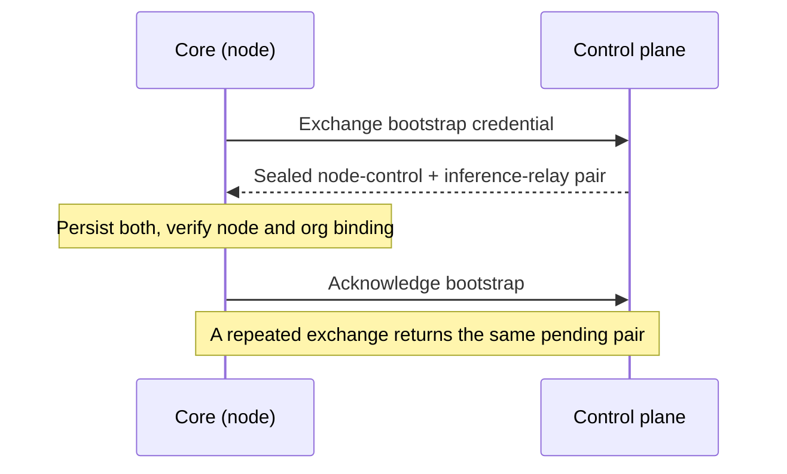
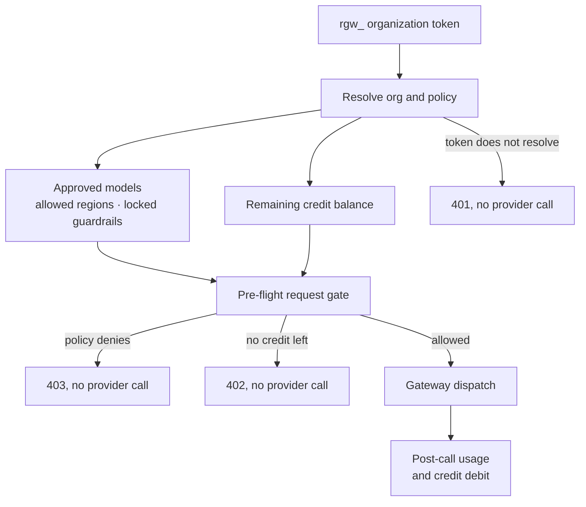

The same Gateway binary that Core runs locally can be deployed once and shared by many
organizations as the hosted managed-cloud **data plane**. Clients point at one Gateway, and each
carries its own minted `rgw_` token.

On every request the Gateway resolves that token to an org, its credit budget, and its effective
policy. It then runs a pre-flight credit gate before dispatch.

## Managed credential lifecycle

Provisioned nodes contact the public control-plane API for bootstrap and enrollment. When the
website and API use different origins, the website origin is reserved for browser sign-in and
billing callbacks. It is not the node bootstrap endpoint.

Provisioning is a two-phase exchange (exchange, then acknowledge):

1. A short-lived bootstrap credential obtains one sealed credential generation for its assigned
   node.
2. Core durably stores the returned **node-control** and **inference-relay** credentials.
3. Core verifies the node and organization binding, then acknowledges the bootstrap.

Repeated exchanges return the same pending generation rather than minting competing pairs.
Rotation follows the same persist-then-ack rule.



The data plane validates credential purpose and requested operation, in addition to organization,
team, node, expiry, and revocation state:

| Credential | Accepted on |
|---|---|
| Inference relay | Inference routes |
| Node control | Lifecycle and resolution routes |

A credential with conflicting tenant authority or an omitted operation is rejected instead of
falling back to broader access.

<Callout type="warn">
This is a **hosted-only** path and runs as a **single replica**. Budget and rate-limit counters
and the resolve cache are in-process maps, so N replicas each grant a full quota. Only the response
and embedding caches can be shared, through the
[Redis cache backend](/docs/gateway/reliability#shared-redis-cache-backend). Deploy one instance per
fleet.

When there is no `CONTROL_PLANE_URL`, the dynamic path is a no-op and the Gateway behaves as the
ordinary single-org process documented in [Configuration and auth](/docs/gateway/configuration).
</Callout>

## Per-request org identity

A standalone Gateway authenticates one org at startup with its own `rgw_` key. The multi-tenant
path instead resolves the org **per request** from whatever `rgw_` bearer the client sent. Any
valid, non-revoked token resolves to its own org.

```http
Authorization: Bearer rgw_<org-token>
```

Resolution goes through `resolve_token` (`apps/gateway/src/policy/mod.rs`), which calls the control plane:

```http
GET {CONTROL_PLANE_URL}/api/control-plane/gateway/resolve
x-gateway-key: rgw_<org-token>
```

The response maps to a `ResolvedOrg` carrying the fields the pipeline needs to attribute and gate the request.

| Field | Meaning |
|---|---|
| `org_id` | The organization the token belongs to |
| `managed_inference` | Whether the org bills through the credit wallet. Only managed tenants get the pre-flight credit gate; BYOK / self-hosted do not |
| `remaining_budget_micro_usd` | Authoritative remaining credit in micro-USD, or `None` when uncapped. `Some(b)` with `b <= 0` means the wallet is exhausted |
| `policy` | The org's effective policy - `approved_models` allowlist, `locked_guardrails`, `allowed_regions`, and the cascaded firewall overlays |
| `limits` | The org's budgets and rate limits: an org-wide cap, a member default, and per-member, per-team, and per-key caps. Missing means no limits |
| `policy_version` | A hash of the effective policy and limits, so a Gateway can detect a change cheaply |

The control plane has already cascaded org, team, project, and user layers and applied admin
locks. The data plane receives one resolved policy and enforces it. It does not re-derive the
cascade. How those layers are written and combined is on
[Organization policy on nodes](/docs/gateway/organization-policy) and
[Guardrail policies](/docs/gateway/guardrail-policies). Owners and admins save organization-level layers and
locks from the organization's **Policies** settings, and a successful save confirms the new policy
revision.



### Per-user attribution

An `rgw_` token proves the organization, not the person. The bare `x-ryu-user-id` header is caller
input, so the hosted path ignores it. A Ryu node forwards the signed-in caller's identity token as
`x-ryu-user-jwt` instead.

The Gateway verifies it offline against the control plane's published signing keys
(`/api/auth/jwks`, cached). It accepts only EdDSA tokens that:

- are unexpired;
- carry the expected issuer and audience;
- list the resolved organization among the user's organizations.

On success the request is attributed to that user and to the user's teams in that organization, and
member and team limits then apply. Any verification failure attributes the request to the
organization alone, so org and key limits still apply.

### End-user identity

If your application serves its own users through an `rgw_` key, name the person behind each
request with the `x-ryu-end-user` header:

```http
x-ryu-end-user: <your user id>
```

Send your internal user id or a hash of it, never an email address or phone number.

- The value is 1 to 128 printable ASCII characters with no spaces.
- Use a `session:` prefix for a logged-out visitor.
- A missing header is fine.
- A malformed value, or the header sent more than once, is refused before anything runs with
  `400`, `type: "invalid_request_error"`, `code: "invalid_end_user"`.

The Gateway hashes the value with a secret salt scoped to your organization as soon as the
organization is known, then drops the raw value. It never appears in audit rows, the live traffic
feed, logs or any provider request. The same end-user id in two organizations produces unrelated
hashes.

Who a request is attributed to follows this order:

1. A verified Ryu user (see above), unless the key serves end users.
2. Your end user from `x-ryu-end-user`, only on a key flagged as serving end users. Keys are not
   flagged by default; an organization admin turns on **Serves end users** for a key under
   **Organization → Gateway keys**. On any other key the header is recorded but does not change who
   the request is attributed to, so a signed-in user cannot appear as a different person on each
   request.
3. The `rgw_` key itself.
4. The organization.

Audit rows record the id of the `rgw_` key that made the request.

### Identity sent to upstream providers

Providers attribute abuse to the identifier a request carries. On a hosted Gateway every provider
request carries an opaque identifier that Ryu derives from the attribution above, in the format
`ryu.<version>.<32 hex characters>`. It is stable for the same subject, reveals nothing about the
user, and cannot be chosen by the caller.

Any `user`, `safety_identifier` or `metadata.user_id` your request carries is removed first, so a
request can never reach a provider under an identifier you supplied.

| Provider | Field |
|---|---|
| Anthropic | `metadata.user_id` (any other `metadata` you send is not forwarded) |
| OpenAI chat | `safety_identifier` |
| OpenAI embeddings and images | `user` |
| OpenRouter | `user` |
| Vercel AI Gateway (chat, hosted Gateway only) | `safety_identifier` |
| Fireworks (chat) | `user` |
| Every other provider, and OpenAI speech and transcription | None: the provider does not document an end-user field, so the identity stays in Ryu's own records |

The identifier never changes your prompt, messages, tools or prompt-cache breakpoints, so cache hit
rates are unaffected.

A self-hosted Gateway, or one on a managed node, forwards the request body as you sent it and adds
no identifier. Because those Gateways keep the identifier you send, they never offer the Vercel AI
Gateway route, which carries only requests stamped with Ryu's identifier.

### Hard-401 on an unresolved token

An `rgw_`-shaped bearer that does not resolve (invalid, revoked, or the control plane is
unreachable) maps to a hard `401`. It is never let through as anonymous. The resolved context sets
`is_master_key = false`, so admin routes still reject it.

### Account standing

Every resolution also carries the key's platform standing. A suspended organization or key, or a
banned owner, still resolves, and the Gateway refuses the request with a specific code instead of
a generic `401`.

Throttled and restricted accounts, enforcement steps, provider safety refusals, and policy
availability are covered on [Account standing on hosted Gateways](/docs/gateway/account-standing).

## The resolve cache

Resolving a token is a control-plane round-trip, so the Gateway caches the outcome with separate
lifetimes for successful and failed resolutions. The raw token is only used as an in-memory key and
is never logged. The cache is enabled only when a managed control plane is configured.

| Outcome | TTL | Why |
|---|---|---|
| Positive (resolved org) | 60s | Keeps the hot path off the control plane, and bounds budget staleness: a topped-up org auto-recovers within one window |
| Negative (invalid / revoked / unreachable) | 10s | Blunts a resolve-DoS from a flood of bad bearers, but short enough that a just-minted token is not locked out for long |
| Refusing or unreadable standing, or an unreadable credit balance | 10s | A lifted suspension or a recovered control plane serves again quickly |

Limits:

- The cache holds at most 4,096 results. It removes expired results during access and evicts the
  oldest result when full.
- Bearers longer than 256 bytes are rejected before resolution.
- At most 32 uncached resolutions run at once. A request beyond that limit, or a request for a token
  another request is already resolving, receives a retryable `429` without waiting or contacting
  the control plane again.

These temporary failures are not cached as invalid credentials, and existing fresh cache entries
remain usable while resolution is busy. A rejected request does not call a model provider.

The Gateway re-fetches its own key's resolution every 60 seconds. When the reported
`policy_version` changes, cached resolutions for that organization are dropped, so a policy or
limits edit applies on the next request instead of after the positive TTL. The last version is
shown in the admin view of `GET /health`.

## Budgets, credit gates, and metering

Organization budgets and rate limits, the pre-flight credit gate, per-tool-call debits, and remote
sandbox metering are on [Hosted budgets and credit gates](/docs/gateway/hosted-budgets).

## Deploying a managed Gateway

A managed Gateway is a long-running service. Run one instance for the deployment and keep its
configuration and audit data on durable storage. On a non-loopback bind, set `GATEWAY_MASTER_KEY`
before the service starts. Keep the health endpoint public only when your deployment needs an
external liveness check; protect all model and admin routes with Gateway auth.

## Hosted Gateway restrictions

A Gateway treats itself as hosted only when it loads its provider keys from the managed control
plane's vault. Fleet mode (`fleet = true` or `RYU_GATEWAY_FLEET=1`) does not make a Gateway hosted.
It only hardens exposure, so a self-hosted Gateway behind its own proxy can set it and keeps the
behavior described elsewhere in these docs.

A hosted Gateway spends Ryu-owned provider credentials on behalf of many organizations, so it turns
off the routes and inputs that cannot be screened or attributed per request:

| Route or input | On a hosted Gateway |
|---|---|
| `/passthrough/anthropic/*` and `/passthrough/openai-responses/*` | Not mounted; requests return `404` |
| Admin routes such as `/v1/config`, `/v1/audit`, `/v1/doctor` and `/v1/egress/posture` without the master key | Refused with `401` even from a loopback peer with `require_auth = false`, because a caller behind a co-located load balancer also arrives from `127.0.0.1`. The Gateway also refuses to start with `require_auth = false` |
| `POST /v1/batches` | Refused with `403`, `type: "policy_violation"`, `code: "feature_not_permitted"`, `layer: "platform"` |
| An `rgw_` token anywhere in a URL query parameter name or value, such as Gemini's `?key=`, a token behind an auth scheme in any letter case, inside an encoded JSON value, or after a `;` or `,` separator | Refused with `401 invalid_api_key` before the token is resolved, even when a valid header key is also present |
| Any other `?key=` value on the Gemini route | Ignored; authenticate with the `Authorization` or `x-goog-api-key` header |
| A chat request that declares any tool other than `{"type": "function"}`, such as an Anthropic server tool (`web_fetch_20250910`, `web_search_20250305`, `code_execution_20250825`), or a typed Anthropic tool on `/v1/messages` | Refused with `403`, `type: "policy_violation"`, `code: "feature_not_permitted"`, `layer: "platform"` before any provider is chosen |
| A chat request that sets `plugins`, `web_search_options`, `transforms`, `route` or `search_parameters` to a non-empty value, or names the `:online` model variant (in `model` or in `models`). These make the upstream search the web or fetch content the Gateway cannot screen | Refused with `403`, `type: "policy_violation"`, `code: "feature_not_permitted"`, `layer: "platform"` before any provider is chosen |
| An `anthropic-beta` header value other than `prompt-caching-2024-07-31` or `extended-cache-ttl-2025-04-11` on `/v1/chat/completions`, `/v1/messages` or `/v1/responses`, including a list that mixes one of those with any other value. When the header is sent more than once, every line is checked | Refused with `403`, `code: "feature_not_permitted"`, `layer: "platform"` |
| An image, speech, transcription or video request that turns a vendor safety setting down: `disable_safety_checker`, `enable_safety_checker` or `safety_checker` set to switch the checker off, `safety_tolerance` above `2`, `safety_filter_level` looser than `block_medium_and_above`, or `moderation` other than `auto`, at any depth of the body including a nested `input`. Names match in any letter case and with or without separators (`safetyTolerance`, `DISABLE_SAFETY_CHECKER`), a `safety_checker` object such as `{"enabled": false}` counts, and so does a setting inside a JSON object held in a string field such as `workflow_json` | Sent with each named setting rewritten to its safe value, inside the string when it was held in one. Settings the request does not name are never added |
| An image, speech, transcription or video request that references LoRA, adapter or model weights: a field such as `loras`, `lora_url`, `lora_weights`, `hf_lora`, `weights` or `adapter_path` with a value, or any URL or path ending in `.safetensors`, `.ckpt`, `.pt`, `.pth`, `.bin` or `.gguf` (letter case, query and fragment ignored). Field names match in any letter case and when the words run together (`LoRA`, `LoRAs`, `hflora`, `ipadapter`, `customweights`). A weights file also counts inside a list separated by `,`, `\|` or `;` (such as `url\|0.8`), when percent-encoded, or inside a JSON object held in a string field such as `workflow_json` | Refused with `403`, `type: "policy_violation"`, `code: "media_unscreenable"`, `layer: "platform"` before any provider is chosen |
| A chat request whose [context compression](/docs/gateway/compression) fails | Refused with `503`, `type: "service_unavailable"`, `code: "screening_unavailable"`, `layer: "platform"` and a `Retry-After` header, instead of being sent uncompressed |
| A request or response the [hazard screener](/docs/gateway/organization-policy#content-screening) blocks | Refused with `403`, `code: "platform_floor_blocked"` (or `platform_floor_output_blocked` for a response) and the S-codes in `categories` |
| An image, audio or other media input no screener can classify. The hosted Gateway has no image or audio screener yet, so today this is every such input | Refused with `403`, `code: "media_unscreenable"`, `layer: "platform"` before any provider is chosen |
| A request the screener should answer but cannot, for example when it times out | Refused with `503`, `type: "service_unavailable"`, `code: "screening_unavailable"` and a `Retry-After` header |
| A request while the screener runs in reduced mode, past the organization's reduced-mode rate | Refused with `429`, `code: "screening_degraded_throttle"` and a `Retry-After` header |
| A request with more text than the screener can classify | Refused with `413`, `type: "request_too_large"`, `code: "screening_capacity_exceeded"` |
| A `PUT /v1/config` that carries a `screening` section | Refused with `403`, `code: "platform_locked"` |
| Any request while the Gateway holds no version of the [Ryu platform policy](/docs/gateway/organization-policy#ryu-platform-policy-on-hosted-gateways), for example right after it starts while the control plane cannot read the policy | Refused with `503`, `type: "service_unavailable"`, `code: "screening_unavailable"`, `layer: "platform"` and a `Retry-After` header, before any provider is chosen. It is never served under your organization's policy alone |

Batch, query-string, compression, tool, beta and weights refusals each write an audit row, and a
query-string refusal never records the token.

Self-hosted Gateways and Gateways on a managed node keep the behavior described elsewhere in these
docs. The admin view of `GET /health` reports where the Gateway runs in its `custody` field, one of
`fleet`, `managed_node` or `self_hosted`.

## Related

<Cards>
  <DocCard href="/docs/gateway/account-standing" />
  <DocCard href="/docs/gateway/hosted-budgets" />
  <DocCard href="/docs/gateway/configuration" />
  <DocCard href="/docs/gateway/reliability" />
  <DocCard href="/docs/gateway/security" />
  <DocCard href="/docs/gateway/governance" />
</Cards>
