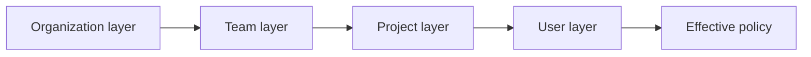
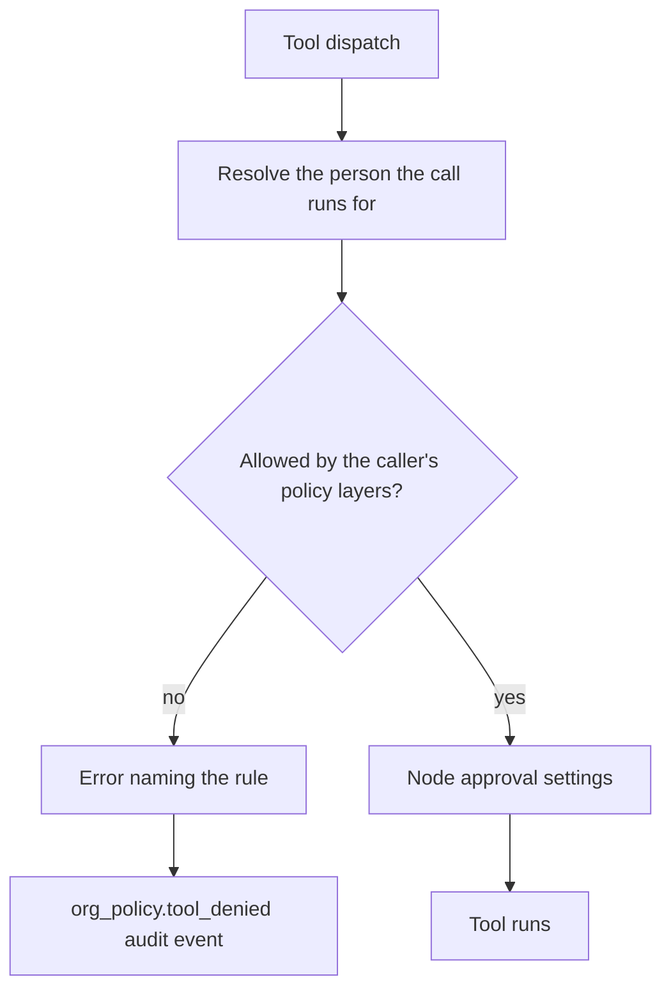

When a node is bound to an organization (a managed cloud node or an enrolled self-hosted node),
the organization's administrators control part of what that node may do through three controls:

- the **tool policy**;
- **locked developer settings**;
- **organization feature toggles**.

A node that is not bound to an organization ignores all three and behaves as a local install.

## Tool policy

The organization's **Policies** settings list the saved layers and can preview the effective
organization, team, or project policy. They include a *Tools and MCP servers* group with three
fields. Each one takes a comma-separated list of patterns, where `*` matches any run of characters
and `?` matches one character. Matching ignores case.

| Field | Matches | Effect |
| --- | --- | --- |
| Allowed tools | Tool ids such as `github.get_repo` | When set, the node may run only matching tools. Empty means no restriction. |
| Denied tools | Tool ids | Matching tools are always refused. A deny wins over any allow. |
| Allowed MCP servers | External MCP server ids such as `github` or `io.acme/*` | When set, tools from any other external MCP server are refused. Built-in Ryu tools are not MCP servers and are governed only by the tool fields. |

<Callout type="warn">
An allowlist covers every tool the node runs, including Ryu's built-in tools such as plan
submission and skill search. If you set **Allowed tools**, include the built-in namespaces your
agents rely on (for example `plans.*` or `skills.*`), or use **Denied tools** to block specific
tools instead.
</Callout>

### The tighten-only cascade

These fields follow the same cascade as the rest of the policy: organization, team, project, then
user layers. A narrower layer can only **tighten** what it inherits, never loosen it.

- **Denied tools** add up: a tool denied at any layer stays denied.
- **Allowed tools** and **Allowed MCP servers** narrow: a narrower layer can restrict to part of
  what the broader layers allow. Leaving the field empty keeps the inherited list rather than
  lifting it.
- Each narrower entry must fall inside an inherited entry (or the reverse): `github.read` narrows
  `github.*`.
- If no entry of either list falls inside the other, nothing is allowed. The effective list shows
  `<deny-all>` and every matching request is refused.
- Patterns that only partly overlap, such as `github.*` and `*.read`, also allow nothing, so list
  the exact entries you want instead.

The same rule covers the other policy lists: approved models and providers, allowed regions, and
locked guardrails. Regions narrow by area, the way the Gateway matches them: a team can narrow `us`
to `us-east-1`, or `eu` to `europe-west1`.

### Locks and ownership

Any member can save their own user layer. The tighten-only rule stops a member from clearing an
organization deny for themselves.

An administrator can also **lock** a field at a broader layer. A lock marks the field as managed by
that layer and shows it as locked to every narrower layer. It never removes a narrower restriction:
a team, project, or user layer can still narrow a locked list and still add tools to a locked deny
list. Neither a lock nor any other layer can loosen what applies.

When a member administrator sets someone's user layer, that layer belongs to the administrator. The
member can no longer change or remove it, through the console or through a config apply or
rollback, until an administrator does. A member can still edit a user layer they created themselves.

### Who can change what

Changes to organization security policy ask the administrator to verify their identity first, the
same check as changing organization feature toggles. This covers:

- saving an organization-level layer, or locking a field;
- changing or removing a layer that has locked fields (in the console or through a config apply);
- rolling the configuration back to an earlier revision;
- setting or removing the organization, per-agent, or team firewall overlay (the team overlay asks
  a team-scoped gateway administrator too).

A member editing their own unlocked user layer is not asked.

Only an administrator who can configure the gateway for the whole organization can change a layer
that has locked fields. Someone who can configure the gateway for one team or project can still
edit that layer while it has no locks.

If an administrator locks a layer while someone else is saving it as an unlocked layer, that save
is refused with a conflict instead of removing the new lock. Reload and try again.

Members see the organization, team, and project layers and their own user layer. Only members who
can configure the Gateway or manage members can see another person's user layer.

### Which layers apply where

- **Team and project.** A server bound to a team applies that team's layer. A server running for a
  project (configured with `RYU_PROJECT_ID`) also applies that project's layer and, when the project
  belongs to a team, that team's layer. A project outside the server's own team is refused.
- **User.** On a server shared by an organization or team, the person a call runs for also gets
  their user layer. It applies to tool calls (as described below) and to model calls, where their
  approved models, providers, regions, and locked guardrails are applied when the Gateway knows who
  the caller is.
- **Unknown caller policy.** If the Gateway has never received a caller's policy, it refuses that
  caller's model requests rather than serving the shared policy.
- **Background work.** Model calls from workflows, apps, and agents that an organization-wide node
  runs in the background reach the hosted Gateway without a signed-in caller. Only the organization
  layer applies to them, even when a member started the work. Run that work on the member's
  personal node when their narrower user layer must also cover it.

### Allowed features

The **Allowed features** field lists the organization feature keys that may be on, as patterns such
as `products.*` or `apps.install`. When it is set, every feature toggle outside the list stays off
whatever its toggle says, both in the console and on organization servers. Leave it empty for no
restriction. It follows the same tighten-only cascade as the other lists.

### How a node enforces it

- A node checks the policy every time a tool is dispatched. This includes agent tool calls,
  workflow and routine steps, and actions that run after an approval.
- On a node shared by an organization or team, the check uses the policy for the person the call
  runs for: the signed-in caller, or the owner of the conversation an agent is working in. That
  person's user layer applies on top of the organization and team layers. A call that runs for no
  particular person, such as a scheduled workflow step, uses the organization and team layers.
- A Gateway's own chat tool loop calls the node's tools without a signed-in caller. On a node
  shared by an organization or team, the node refuses those calls instead of running them with
  only the organization and team layers, so this path can never skip a member's user layer.
- The node only tells the Gateway which conversation a turn belongs to when the person who sent the
  message owns it. A shared conversation never lets one member's turn use another member's tool
  rules or accounts.
- A Gateway that runs Composio actions itself, without a node behind it (for example the hosted
  Gateway or a self-hosted multi-tenant Gateway), applies the same allowed and denied tool rules
  to every Composio action. It uses the caller's policy when the Gateway knows the caller.
- Composio actions use the ids `composio.<ACTION>`, so `composio.*` in **Denied tools** blocks them
  all. A refused action is not offered to the model and is never run. If the Gateway has not
  received the caller's policy, it refuses their tool calls until it does.
- A tool the policy refuses is not offered to models in the node's tool list. A tool list that is
  not tied to a signed-in caller is filtered with the organization and team layers, and a
  person's user layer is still enforced when the tool is called.
- A refused call returns an error that names the rule, for example
  `tool 'github.delete_repo' is denied by your organization's tool policy (rule 'github.delete_*')`.
- Each refusal is written to the node's Gateway audit log as an `org_policy.tool_denied` control
  event.
- The policy is checked before the node's approval queue. A refused tool is never queued for
  approval, so a local approval cannot override the organization's decision. A tool the policy
  allows still goes through the node's normal approval settings.

## Locked developer settings

Organization and team administrators can set defaults for the Git and worktree settings Ryu uses
on a node, along with hook overrides:

- branch prefix, merge method, and draft pull requests;
- review delivery, auto-merge, and auto-addressing pull-request comments;
- archiving chats when their pull requests close;
- instructions and worktree cleanup.

They can also **lock** any of these fields:

- A field locked at the organization layer cannot be changed by the team or user layer.
- A field locked at the team layer cannot be changed by the user layer.
- A locked field keeps the value set at or above the locking layer. If no value is set there, the
  node's own setting or the built-in default applies, and users still cannot override it.
- The worktree root directory is always node-only, so it cannot be distributed or locked.
- When an administrator sets a member's user-layer override, only an administrator can change it
  later. Members see their own user-layer overrides, but not other members'.

Auto-addressing reacts only to feedback from the repository's owner, organization members, and
collaborators; bots, other commenters, and the user's own comments never start a turn. See
[Git workspace controls](/docs/surfaces/desktop/user-guide/git-workspace-controls) for the full
behavior.

In the Ryu desktop app, under the Gateway's **Git** and **Worktrees** settings, locked fields appear
read-only on the User scope with the note *Locked by your organization's administrator*. A user
change to a locked field is not saved.

## Organization feature toggles

The organization's **Features** settings can turn product areas off for everyone, for one team, or
for a single member.

- A member override wins over a team override, which wins over the organization setting.
- A member in several teams gets the strictest team value: if any of their teams turns a feature
  off, it is off.
- On a server bound to a team, only that team's override and layer apply.

Features the policy's **Allowed features** excludes stay off and are marked **Blocked by policy**.
For a member, **Allowed features** is checked against their user layer and each of their teams'
layers, so a team's narrower list also applies to them. When the organization locks **Allowed
features**, only the organization's list applies.

On a bound node, three of them also change what the node accepts:

| Toggle | What the node refuses when it is off |
| --- | --- |
| App installation (`apps.install`) | Installing apps and plugins by id, URL, or bundle, updating installed apps and plugins, adding or editing a custom MCP server, importing OpenAPI or GraphQL tools, and installing a skill from a source |
| Marketplace plugins (`plugins.marketplace`) | Installing and updating plugins and packages from the marketplace catalog, and installing MCP servers, skills, and skill packs from their catalogs |
| Engine updates (`engines.update`) | Updating (reinstalling a newer build of) a local engine |

The node checks the toggles for the person making the request. If it cannot reach the
organization to resolve them and has no earlier answer for that person, it refuses these routes
rather than allowing them.

The Ryu desktop app reads the same values, so it hides the engine **Update** action and explains
disabled installs instead of showing a generic failure. Browsing the catalog stays available.

The hosted Gateway enforces **Hosted web search** (`products.web_search`). When it is off, it
refuses managed web searches that would be billed to the organization's credit balance.

- This toggle applies to the whole organization. A member-level override does not change it.
- Searches through your own provider accounts are unaffected.

See [Web Search and Fetch](/docs/gateway/web-services#hosted-web-search).

## Ryu platform policy on hosted gateways

Ryu's hosted Gateway adds one layer above your organization: the **Ryu platform policy**. Ryu
maintains it, and no organization, team, or member can edit or remove it.

- It uses the same firewall settings as the policies above: scan directions, PII and secret
  redaction, the detection action, the traffic inspector and custom patterns. It can also pin
  evaluators. Limits on which providers and models a request may use are not applied by the hosted
  Gateway yet, so it ignores a version that sets them and keeps the version it already holds.
- Every field in it is locked. Your organization, team and agent policies apply after it and can
  only tighten it. You can add patterns, turn on more protections or narrow the provider and model
  lists, but you cannot turn off a protection the platform policy turns on.
- It applies to every request the hosted Gateway serves, whether it spends Ryu's provider accounts
  or your own keys, because both leave from Ryu's servers. It applies whatever your plan, including
  organizations that do not use managed inference.
- A self-hosted Gateway is not bound by it, and neither is a Gateway on a Ryu Cloud managed node.
  That node holds no Ryu credentials and reaches Ryu's providers through the hosted Gateway, which
  applies the platform policy there.
- The hosted Gateway applies it first, on top of its own base settings, and it can only make those
  stricter. A setting the platform policy leaves unset stays at the Gateway's base value and is
  locked there too, so your policies can still only tighten it.
- Ryu changes it in numbered versions. A version that makes it stricter takes effect at once. A
  version that loosens it waits for a second Ryu administrator to approve it whenever Ryu has more
  than one.
- A failed read never removes it. When Ryu's control plane cannot read the current version, it
  does not hand the hosted Gateway a policy without it, and the hosted Gateway keeps the newest
  version it already received.
- A version the hosted Gateway cannot apply in full is ignored in the same way, for example one that
  pins an evaluator the Gateway does not ship or cannot run in the mode the version asks for.
- A hosted Gateway that has not received any version refuses requests with a retryable `503` whose
  `error.code` is `screening_unavailable` rather than serve them without it.

### Content screening

The hosted Gateway also runs Ryu's [hazard screener](/docs/gateway/model-screening#hazard-screener)
on every request, after the platform policy's patterns and before any provider is called. Fallback
attempts, tool rounds and responses are screened too.

A response is screened over everything the caller would receive: the reply text, tool call
arguments, the model's reasoning, a refusal message and legacy function call arguments. The
adult-content exception follows the model that actually receives the request, so a slot header, a
fallback or a pool member that routes to a different model loses it.

| Category | What happens |
|---|---|
| `S4` (child sexual exploitation) and `S9` (weapons of mass harm) | Blocked. No policy, organization or model setting can lower `S4` |
| `S12` (sexual content) | Blocked, unless the model is one Ryu permits for adult content, where it is recorded as a flag |
| Every other category and prompt attacks | Recorded as a flag; the request goes through |

What a client receives:

| Case | Response |
|---|---|
| A request is blocked | `403`, `type: "policy_violation"`, `code: "platform_floor_blocked"`, `layer: "platform"`, the S-codes in `categories` and a `screening_id` starting with `scr_`. The message is fixed: it never names the matched text, a score or the screener |
| A response is withheld | `403` with `code: "platform_floor_output_blocked"`. A stream ends with a final `data:` frame carrying the same error object instead of `[DONE]` |
| A screener that should answer fails for this request, including an image classifier that times out or errors | `503`, `code: "screening_unavailable"` and a `Retry-After` header. An image is never forwarded without a decision |
| The screener is in reduced mode (no screener available for `S4` or `S9`) | The request is screened by the platform policy's patterns and counted against a per-organization rate. Past it: `429`, `code: "screening_degraded_throttle"` and a `Retry-After` header |
| An image, audio or other media input no screener can classify, or an image, video, speech or transcription request in reduced mode | `403`, `code: "media_unscreenable"`, before any provider is called |
| A request with more text than the screener can classify | `413`, `type: "request_too_large"`, `code: "screening_capacity_exceeded"` |

The screener is a local decision model that runs next to the hosted Gateway on a private network.
There is no image or audio screener yet, so every image, audio or other media input is refused with
`media_unscreenable`.

A third-party screening service is never used by default. Ryu adds one only after recording its
data retention terms, with the approval of a second Ryu administrator. The screener is part of the
platform policy, so a self-hosted Gateway and a Gateway on a Ryu Cloud managed node are not bound by
it.

## Staying current

A bound node rechecks its organization's policy about every 30 seconds, with a small random offset
so that a fleet of nodes does not poll at the same moment. When the policy changes, the node also
refreshes its granted tools and managed settings in the same cycle. Feature toggles and each
person's tool policy are cached for up to one minute.

If a check fails, for example because the network is unavailable, the node keeps using the last
policy it received. A failure never relaxes it to an unrestricted state.

- If the node has never received a person's tool policy, it refuses that person's tool calls until
  it does.
- A managed node that has never received its grants continues to refuse external MCP servers and
  connected sources until it does.

## Related

- [Named guardrail policies](/docs/gateway/guardrail-policies): write a policy once and assign it
  to an organization, team, member, key or agent.
- [Managed data plane](/docs/gateway/managed-data-plane): how the hosted Gateway resolves an
  organization's policy for model traffic.
- [Governing an ACP agent](/docs/gateway/acp-agent-governance): the other layers that apply to
  bring-your-own-harness agents.
- [Audit](/docs/gateway/audit): where control events, including policy denials, are recorded.
