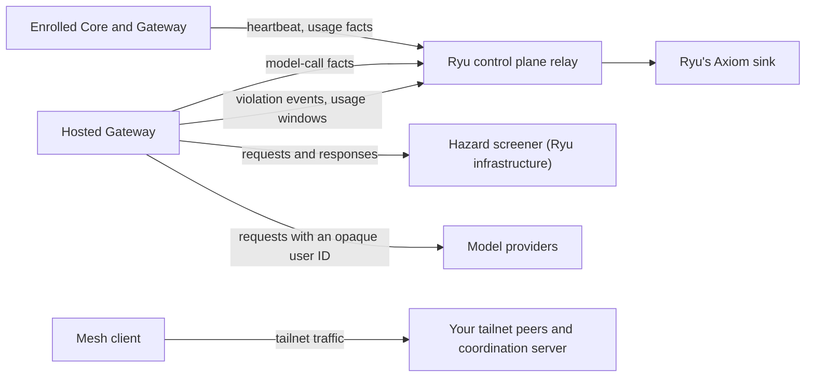

This page continues [Privacy and Telemetry](/docs/surfaces/desktop/transparency). It lists the
destinations that receive data when you use a hosted service, a configured provider, or a
private network.

## Ryu-managed analytics

- **Ryu Cloud-enrolled Core and Gateway:** managed nodes and customer-operated self-hosted nodes
  send a small, typed Core heartbeat and Gateway model-usage facts only when diagnostics export is
  enabled and an OTLP endpoint is set. Unenrolled self-hosted nodes do not send this summary to Ryu.
  - The heartbeat contains Core version, operating system, architecture, and a random event ID.
  - Gateway facts contain operation, provider, model, token counts, latency, outcome, and a stable
    error class.
  - They are relayed to Ryu's control plane. The node never receives Ryu's Axiom token.
- **Hosted Gateway:** Ryu's hosted Gateway sends allowlisted model-call facts (operation, provider,
  model, token counts, latency, outcome, and service version) to the same relay. This is operational
  telemetry on Ryu infrastructure, not the customer's diagnostics destination.
- **What it never collects:** no prompts, completions, files, tool arguments, headers, cookies,
  account IDs, organization IDs, session IDs, provider keys, or response bodies.
- **Ryu's sink:** the control-plane deployment owns the Axiom destination and credentials. Axiom
  exports require an endpoint, an ingest token, and a dataset; a partial configuration disables
  delivery and reports a rate-limited warning without exposing credential values. A self-hosted
  deployment can leave all Ryu sink variables unset; the relay then degrades to a no-op.

## Content screening and third-party processors

- **Ryu's hosted Gateway:** every request and response it serves is checked by Ryu's
  [hazard screener](/docs/gateway/organization-policy#content-screening).
  - In reduced mode, only pattern checks and a rate limit apply.
  - The screener is a local decision model that Ryu runs next to the hosted Gateway on its own
    infrastructure, on a private network with no outbound access.
  - No third-party screening service receives your content by default. Ryu adds one only after
    recording its data retention terms, with the approval of a second Ryu administrator.
  - What the hosted Gateway records about a verdict is described in
    [Gateway audit](/docs/gateway/audit).
- **What reaches Ryu's control plane:** Ryu's hosted Gateway and Ryu-managed nodes send the control
  plane violation events and per-minute usage windows for abuse detection.
  - Each violation event carries a sealed, redacted excerpt of the screened text, at most 2 KB for
    most categories.
  - Excerpts are kept 30 days, longer while an open case, ban, or appeal holds them (then 90 days
    after the last hold is released). Events are kept 400 days.
  - The Gateway's own 72-hour limit applies only to its local copy. See
    [Gateway audit](/docs/gateway/audit#what-the-control-plane-keeps).
- **Identifier sent to model providers:** the hosted Gateway sends each provider an opaque,
  pseudonymous identifier derived from the user, end user or key the request is attributed to, never
  an email address. See [Identity sent to upstream providers](/docs/gateway/managed-data-plane#identity-sent-to-upstream-providers).
- **Media on the hosted Gateway:** Ryu does not run an image or audio screener yet, so the hosted
  Gateway refuses image, audio and other media inputs rather than sending them to a provider
  unchecked.
- **Your own Gateway:** screening is off by default and is your policy, not Ryu's.
  - A remote decision API such as TypeSafe's Jev as a screener needs an explicit
    `allow_remote_processor = true`. The text of every screened request is then sent to that third
    party under its own terms.
  - A local decision model or guard model on your own machine sends nothing off the node.
  - An `inspector` or guard backend pointed at a remote endpoint sends the screened text there, even
    without `allow_remote_processor`. The previous point holds only for local endpoints.

  See [Hazard screener](/docs/gateway/model-screening#hazard-screener).

## Private network and Tailscale Funnel

- **Default:** off. The Tunnel toolkit starts only when you enable it, and Tailscale Funnel is used only when
  you select it as the webhook ingress.
- **Funnel scope:** the Funnel publishes only Core's webhook paths, the Composio webhook and the
  `/api/workflows/` prefix, never Core's whole port. Core turns the Funnel off when you stop the mesh and
  clears a broader Funnel left by an older build. See
  [Tailscale Funnel scope](/docs/core/private-networking#tailscale-funnel-scope).
- **Mesh client:** Ryu runs the Tailscale or Headscale client as an ordinary user with Tailscale SSH off. It
  does not open the client's SOCKS5 and HTTP proxy listeners unless you ask for them. While the mesh is
  enabled, Core does not treat loopback connections as local, because tailnet peers arrive that way. See
  [Harden your tailnet](/docs/core/private-networking#harden-your-tailnet).
- **What leaves the node:** the mesh sends traffic to the peers and coordination server of your tailnet.

## Community statistics

Community statistics report per-skill activity only for independently verified public catalog
installations, matched to their installed source and instructions.

- **No per-skill counter:** privately discovered skills, local replacements, unverified custom or
  private sources, and older installations without a public witness do not send a skill identifier
  or per-skill counter. Reinstalling from a verified public catalog can establish that witness.
  Ordinary aggregate usage remains available.
- **Public listings only:** the reporting service admits per-item counters only for its currently
  live, public listings and public collections. Unknown, organization-only, and unlisted items do
  not expose community counts, including previously received rows. Public third-party items without
  a public entry on that service can therefore be undercounted.
- **Other definitions:** agent, workflow, and app definitions also need a verified public origin.
  Local replacements do not inherit a public item's activity counter.

## Related

<Cards>
  <DocCard href="/docs/surfaces/desktop/transparency" />
  <DocCard href="/docs/legal/privacy" />
</Cards>
