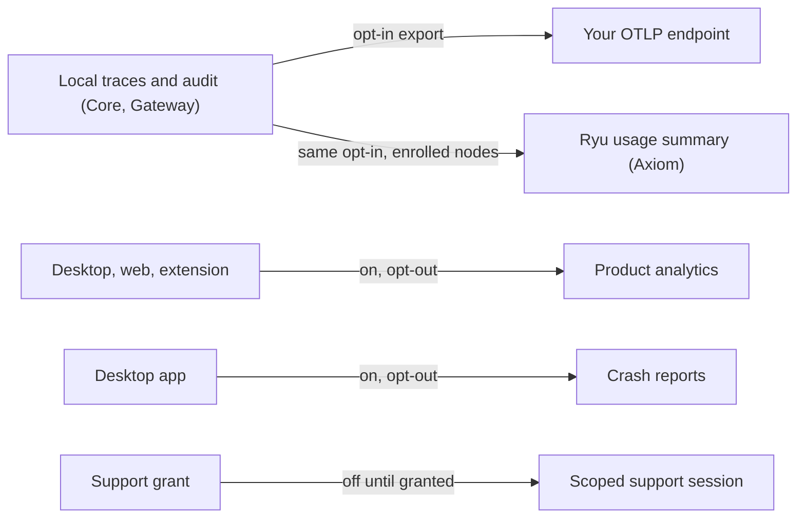

Ryu is local-first and encrypted by default. Each telemetry stream, support control, and local
record below has its own default and data boundary. Local traces and audit records have separate
retention controls, and not all of them have an off switch.

The layer a stream lives in decides its default:

- The **data plane** is anything that can touch a prompt, a completion, agent content, a file path,
  a tool argument, memory, or a Space: the Rust **Core** and **Gateway**. Local traces and audit
  records stay on the device. [Diagnostics export](#diagnostics-export-otlp) is **off by default
  and opt-in**.
- The **closed UI plane** is the desktop app shell, the website, and the extension: which screen you
  opened, whether onboarding finished, whether an install succeeded. Anonymous, content-free product
  analytics here is **on by default and opt-out**.
- **Support access** is a short, user-granted exception. It is **off by default** and auto-expires.

<Callout type="info">
  Your prompts, conversations, files, and any agent content are never part of product analytics,
  Ryu-managed telemetry, or crash reports. Content can leave a node through configured model
  providers, apps and network tools, optional cross-device sync, off-node backups, or a support
  bundle you explicitly grant.

  Gateway policies cover requests routed through that endpoint; separate integrations have their own
  destinations and permissions.
</Callout>

[Cross-device sync](/docs/surfaces/desktop/user-guide/cross-device-sync) (off by default) and
[S3 backups](/docs/surfaces/desktop/user-guide/s3-backups) send content off the node when you turn
them on. Review them separately from telemetry preferences.

## How Desktop presents the disclosure

The final Desktop onboarding screens separate a short explanation of actions, background work, and
approval control from the privacy choices. The privacy screen comes before the first chat and shows:

- product analytics, community stats, and crash reports - on by default;
- diagnostics export - off by default.

The profile-activity choice is on by default and lives in **Settings → Privacy**. Each choice is
saved to the node's canonical preference store and can be changed later in **Settings → Privacy**.
Completing the privacy screen acknowledges the first-run disclosure, so Desktop does not show a
second privacy dialog on app launch.

When you switch nodes or accounts, review the privacy choices for that selection before changing
them. A failed save keeps the previous saved consent in effect. Retry the choice after you resolve
the connection or permission error.

Turning product analytics or crash reports on takes effect in Desktop after the node confirms the
save. Turning either off stops its Desktop reporting while the save is pending. If the save fails,
Desktop restores the previous choice and reports the error so you can retry.

Privacy choices read the node's effective value, in this order:

1. A saved choice.
2. The operator's environment setting.
3. The default.

This applies to product analytics, community stats, crash reports, diagnostics export, and the local
support-access enabled flag. Reading a choice does not save a new preference. The node returns an
error when its preference store is unavailable. Local support access also checks its separate
expiry, so an enabled flag alone does not make an expired grant active.

## Training commitment

Ryu never uses your chats, files, or activity to train Ryu models. Core and Gateway are open source,
so you can inspect how they handle your data and run them on your own infrastructure. When you choose
a model provider, app, or plugin for a task, that service may process the content needed to perform
that task; review its own terms and privacy policy before connecting it.

## Closed UI plane (on by default, opt-out)

### Product analytics

- **Default:** on (opt-out). Desktop discloses it in the final onboarding privacy step; the
  website and extension use their own first-run surfaces.
- **What it collects:** a fixed, typed set of content-free events such as onboarding completed, an
  agent installed or removed, the active engine swapped, a model install started or completed, a chat
  turn started (count only), a feature enabled or disabled, and an error surfaced (by stable code). The
  desktop event schema is a discriminated union of scalars only, so there is no free-text field to
  misuse.
- **What it never collects:** prompt or completion text, conversation content, file paths, tool
  arguments, or any agent content. Identity is a random install ID that is not linked to your account
  (no `identify` call is ever made).
- **See what is sent:** the desktop ships a local egress audit log (a ring buffer of the exact typed
  events that were sent) and an in-app inspector in **Settings → Privacy**.
- **How to disable:**
  - Desktop: toggle off in **Settings → Privacy**, which writes the `product-analytics-enabled`
    preference (default `true`). Env mirror `RYU_PRODUCT_ANALYTICS_ENABLED=false`.
  - Web: the site reads a self-contained local gate (`localStorage` key `ryu:product-analytics-enabled`
    set to `false`), because the website has no Core connection. With no PostHog key configured the web
    provider is a graceful no-op and collects nothing.

### Crash reports

- **Default:** on (opt-out), as a separate consent tier from product analytics.
- **What it collects:** scrubbed crash and error stacks (desktop renderer and Rust panics) to fix what
  breaks.
- **What it never collects:** prompt or agent content. The install ID is the same random,
  account-unlinked identifier used by analytics.
- **When the renderer cannot recover:** Desktop shows the message **Something broke** with
  **Try again** and **Reload** actions. Developer mode also exposes **Copy console** and **Copy
  diagnostics** in **Settings → Developer**. See [Manual diagnostics actions](/docs/surfaces/desktop/support-access#manual-diagnostics-actions).
- **How to disable:** toggle off in **Settings → Privacy**, which writes the `crash-reports-enabled`
  preference (default `true`). Env mirror `RYU_CRASH_REPORTS_ENABLED=false`. This is independent of the
  product-analytics toggle, so you can keep one and drop the other.

## Data plane (local by default, export is opt-in)

### Local run traces and Gateway audit

- **Default:** on, but **local-only** and never exported on their own. Run traces live in
  `~/.ryu/db/traces.db` and the Gateway audit lives in its own SQLite store.
- **What it records:** per-run spans (tool and model calls) where tool arguments are stored as a
  SHA-256 hash, never the raw arguments, plus the Gateway audit (tokens, cost, latency, provider,
  model, errors) with API keys redacted to a short prefix.
- **How to disable:** these are local stores you own; there is no off switch because nothing leaves
  your device. They only egress if you turn on diagnostics export below.

Apps with ordinary usage permission cannot read administrative audit records. An app needs the
separate **Reads administrative Gateway audit records across callers** permission and node
administrator authority. Existing app approvals do not acquire that permission automatically.

Community statistics count only verified public catalog items. See
[Community statistics](/docs/surfaces/desktop/data-destinations#community-statistics).

### Diagnostics export (OTLP)

- **Default:** **off (opt-in)**.
- **What it does:** when, and only when, you opt in **and** configure a destination, Core and Gateway
  send redacted local trace and audit spans to the OTLP endpoint you choose: PostHog, Axiom,
  Grafana, a self-hosted Collector, or another OTLP backend.
- **Ryu summary on enrolled nodes:** on Ryu Cloud-enrolled managed or self-hosted nodes, the same
  opt-in also sends a small Core heartbeat and allowlisted Gateway model-usage summary to Ryu's
  Axiom sink. It does not receive the raw OTLP spans, prompts, completions, or tool arguments.
  Unenrolled local installs do not send this summary. The Axiom ingest token stays server-side.
- **What it never collects by default:** in the default metadata-only mode the exported records carry
  the same redacted, content-free shape as the local stores (hashed args, redacted keys). Prompts,
  responses, and tool data are exported only if you also turn on
  [content mode](/docs/surfaces/desktop/diagnostics-reference#content-mode).
- **GenAI attributes:** export sends the experimental GenAI semantic conventions (`gen_ai.*`
  attributes: model, provider, input and output tokens, latency). Core's agent and tool spans always
  carry them. The conventions define no cost field, so cost is derived downstream from tokens.
- **How to enable or disable:**
  - Set the destination in **Settings → Privacy**, which writes `diagnostics-otlp-endpoint`
    (empty by default) and flips `diagnostics-export-enabled` (default `false`). Env mirrors
    `OTEL_EXPORTER_OTLP_ENDPOINT` and `RYU_DIAGNOSTICS_EXPORT_ENABLED`. Restart Core after changing
    the endpoint so its exporter binds the new destination.
  - With the toggle off or no endpoint set, **nothing egresses**: the exporter filter blocks spans
    and the Ryu summary relay stays off. Turning export off mid-session also drops spans that were
    already open (for example a long agent turn) or still queued, instead of sending them later.
  - When Core manages a Gateway sidecar, it forwards the same consent and endpoint, and turns on the
    GenAI spans for it whenever export is on. A separately managed Gateway needs its own diagnostics
    endpoint configuration and `OTEL_SEMCONV_STABILITY_OPT_IN` containing `gen_ai`.
  - Destinations that need auth use the standard `OTEL_EXPORTER_OTLP_HEADERS` env. For PostHog there is
    a convenience env (`RYU_POSTHOG_KEY`) that derives the bearer header for you.

The endpoint format, exporter presets, content mode, trace context propagation, test span, and
span reference are in [Diagnostics Export Reference](/docs/surfaces/desktop/diagnostics-reference).

### Other destinations

Ryu-managed analytics for enrolled nodes, content screening and third-party processors, and
private network exposure are described in
[Data Destinations](/docs/surfaces/desktop/data-destinations).

## Template Rewards usage (pilot)

- **Default:** on only while the invite-only [Template Rewards pilot](/docs/programs/template-rewards)
  is rolled out to your signed-in account; otherwise nothing is sent.
- **What it collects:** when you chat with an agent you installed from the Marketplace, Desktop
  sends that listing's id to your Ryu account at most once per listing per day. No prompts,
  messages, or agent output.
- **What Ryu stores:** your account id, the listing, its publisher, the UTC day, and the license your
  organization holds for that listing. A report is ignored when your organizations hold no license
  for the listing. Publishers see per-template totals, never who used a template.
- **How to disable:** temporary chats never report. Signed-out use never reports.

## Profile activity (streak)

- **Default:** on (opt-out), and only while you are signed in to a Ryu account. This signal is
  linked to your account; it is not anonymous.
- **What it collects:** after Ryu runs a chat or agent turn for your signed-in account on this
  device, including agents started by a schedule, a workflow, or a channel, the node tells your Ryu
  account that the account was active today. Ryu Cloud managed agents that run for your account
  record the same kind of marker.
- **What does not count:** the built-in
  [Patrol](/docs/surfaces/desktop/user-guide/agents#patrol-watches-your-setup) health and security
  bot.
- **What your account stores:** for each UTC day with activity, the day, the time of the first and
  last activity that day, and a count per source (Ryu on your devices, or Ryu Cloud managed agents).
  These days keep your [profile streak](/docs/surfaces/public-profiles#streaks) going.
- **Device usage totals:** when this device's Gateway does not already report usage to Ryu Cloud
  (the usual local desktop setup), the same signal also sends this device's daily totals so your
  profile stats and activity heatmap include local use:
  - input and output tokens, requests, sessions, and requests per model for that UTC day;
  - a random id that identifies this device's totals and is not used for anything else.
- **When totals are sent:** at most every 30 minutes while they change, plus one final update for the
  previous day after UTC midnight. They are sent only for an account that stayed signed in on this
  device for that whole day (or since Ryu started that day). Usage from before a sign-in or account
  switch is never included, and failed or blocked requests are not counted as requests.
- **Storage limits:** your account stores one row per device and UTC day, for up to five devices a
  day. A Gateway that already reports usage, such as a hosted Gateway, never sends these totals, so
  nothing is counted twice.
- **What is never sent:** prompts, messages, files, agent names, or agent output. Activity markers
  add nothing to your token or request totals.
- **Points:** device usage totals are self-reported, so they count toward your profile totals but
  never earn points. A day with only this activity earns no points, including no streak bonus;
  points still come only from metered usage.
- **How to disable:** turn off **Sync activity on this device to your profile** in **Settings →
  Privacy → Usage & crash data** (or **Profile activity** in the terminal app's Settings → Privacy),
  which writes the `profile-activity-enabled` preference (default `true`). Signed-out use never
  reports.
- **With it off:** chats, agent runs, and usage on this device no longer reach your profile. Your
  streak and totals count only usage your account already records, such as requests through a
  hosted Gateway, and Ryu Cloud managed agents.

## Control-plane server logs

- **Default:** on, on Ryu's own machines (so there is no consent question for your device).
- **What it collects:** one canonical wide event per request hop (method, route, status, duration,
  trace and span IDs) shipped to Ryu's Axiom sink via OTLP. No user content. Export requires the
  endpoint, ingest token, and dataset; if any are missing, nothing is sent.
- **How to disable:** this runs server-side on Ryu Cloud infrastructure, not on your machine, so there
  is no client toggle. Self-hosters control their own server-side Axiom connection; Core and Gateway
  do not receive or need Ryu's Axiom credentials.

## Support access (off by default, user-granted)

Support access is an exception you grant, not passive telemetry. It is off by default and
auto-expiring. See [Support Access](/docs/surfaces/desktop/support-access) for the control-plane
and local Core flows.

## At a glance

| Stream | Layer | Default | Content | How to turn off |
| --- | --- | --- | --- | --- |
| Run traces | Core | On, local-only | Hashed args, no raw | Local only (never exported alone) |
| Gateway audit | Gateway | On, local-only | Tokens and meta, keys redacted | Local only (never exported alone) |
| Diagnostics export (OTLP) | Core and Gateway | **Off (opt-in)** | Redacted local spans to the chosen endpoint or exporter preset (prompts and responses only with the separate content mode); allowlisted summaries to Ryu Axiom on enrolled nodes | `diagnostics-export-enabled` / `OTEL_EXPORTER_OTLP_ENDPOINT` / `diagnostics-otlp-preset` |
| Product analytics | Desktop, Web, Extension | On (opt-out) | Content-free event enum | `product-analytics-enabled` toggle in Settings → Privacy |
| Ryu-managed Gateway telemetry | Ryu hosted Gateway and Ryu-managed nodes | On (Ryu infrastructure) | Model/provider/tokens/latency; no prompts or responses except a redacted excerpt of at most 2 KB when a guardrail flags or blocks | Ryu deployment configuration |
| Abuse-detection usage windows and violation events | Ryu hosted Gateway and Ryu-managed nodes | On (Ryu infrastructure) | Per credential and minute: outcome, deciding layer and safety-category counts, tokens, cost, per-model and per-provider counts, latency buckets. Violation events with a sealed redacted excerpt. Excerpts are kept 30 days (longer while a case, ban or appeal holds them, then 90 days); events 400 days | Does not apply to a self-hosted or BYOK Gateway |
| Content screening (hosted) | Ryu hosted Gateway and Ryu-managed nodes | On (Ryu infrastructure, no third party) | Requests and responses classified next to the Gateway, except in reduced mode, when only pattern checks and a rate limit apply | Platform policy; does not apply to a self-hosted Gateway |
| Provider user identifier | Ryu hosted Gateway | On (Ryu infrastructure) | Opaque, pseudonymous per-user identifier sent to the model provider with each request | Platform policy; a self-hosted Gateway adds none |
| Remote screener (self-hosted) | Your Gateway | **Off (opt-in per backend)** | Screened text sent to the third party you name | Leave `allow_remote_processor` off |
| Crash reports | Desktop | On (opt-out, separate) | Scrubbed stacks | `crash-reports-enabled` toggle |
| Server logs | Control plane | On (Ryu's machines) | Wide events, no user content | Server-side only |
| Template Rewards usage | Desktop to control plane | Pilot accounts only | Listing id and day, once per day | Temporary chat or sign out |
| Profile activity (streak) | Core to control plane | On (opt-out), signed in only | "Active today" for your account; daily usage totals per device when its Gateway does not report usage; no content, no points | `profile-activity-enabled` toggle in Settings, Privacy |
| Private network and Funnel | Core | **Off (opt-in)** | Tailnet traffic to your own peers and control server; the Funnel serves only webhook paths | Turn off the Tunnel toolkit or choose another webhook ingress |
| Support access (cloud) | Control plane | **Off (user-granted)** | Scoped, actor recorded | Account settings, revoke any time |
| Support access (local) | Core | **Off (user-granted)** | Redacted diagnostics, secret-stripped | `support-access-local-enabled`, off by default |

Product analytics and crash reports are separate consents. Cloud support access and local support
access are also separate grants. You can turn each one on or off independently.

Continue with [Desktop user guide](/docs/surfaces/desktop/user-guide), [Core observability](/docs/core/observability), [privacy](/docs/legal/privacy), [data and storage](/docs/surfaces/desktop/user-guide/data-and-storage), and [Security](/docs/security).
